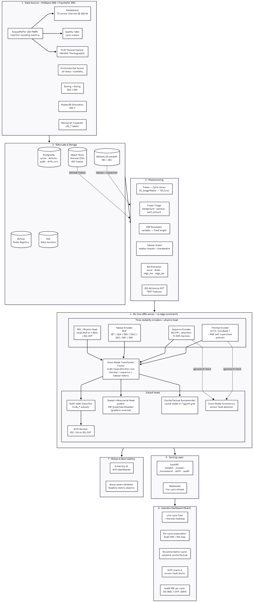
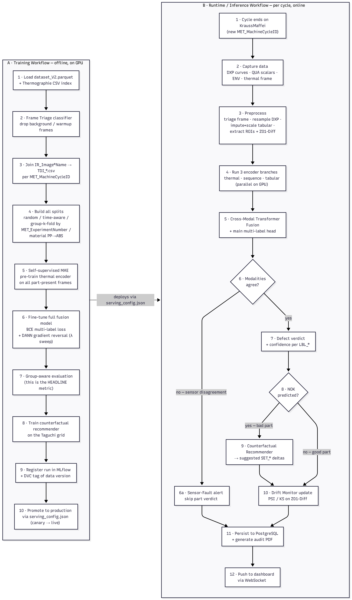

# FusionQC: multi-sensor defect detection for injection moulding

A multimodal deep-learning system that predicts defects in injection-moulded parts by fusing four data streams from the machine: thermal images, process-curve time series, machine and quality scalars, and warpage images. It also explains each decision, suggests setpoint changes, and watches for drift and sensor faults.

Mini project, Department of AI and Data Science, M S Ramaiah Institute of Technology (2026). Built by a team of four. Team member [@DarshanCHMSR](https://github.com/DarshanCHMSR). The cross-modal fusion model and its domain-adversarial training were my part.



## Vision

Manual inspection of moulded parts catches roughly 70-80% of defects, takes 20-30 seconds per part, and gets worse with fatigue. The machine already produces hundreds of signals per cycle. FusionQC turns them into a verdict in under a second, with these goals:

1. **Predict defects per part, per cycle.** Multi-label output for 8 labels: sink marks, sprue circle, underfilled, old granulate, three streak levels, and overall NOK.
2. **Be honest about generalization.** The data comes from a designed experiment (47 setpoint cells, 12 parts each). Random splits leak the setpoint, so the headline metric uses group k-fold by experiment number.
3. **Say why.** Per-modality attention weights and Grad-CAM explanations.
4. **Say what to change.** A counterfactual recommender proposes setpoint deltas that move a NOK part towards OK.
5. **Notice trouble early.** Drift monitoring (PSI, KS, embedding drift) and a cross-modal consistency check that flags sensor faults instead of giving a wrong verdict.
6. **Run on the shop floor.** A FastAPI service and operator dashboard (planned, see roadmap).

## What exists today

| Area | Status |
|---|---|
| Data pipeline (parquet, thermal CSV frames, DXP sequences, transforms, missing-modality handling) | Implemented |
| Encoders: thermal (EfficientNet-B0 + ROI physics head), visual (ResNet-50 with section attention), sequence (TCN with squeeze-excite), tabular (MLP) | Implemented |
| Cross-modal transformer fusion with learned modality tokens and a `[MASK]` token for missing modalities | Implemented |
| Domain-adversarial (DANN) training with gradient reversal and lambda sweep | Implemented |
| Training, group k-fold / time-aware / random splits, focal loss, threshold tuning | Implemented |
| Evaluation script comparing split strategies | Implemented |
| Explainability, counterfactual recommender, drift monitor, consistency checker | Implemented (modules and notebooks) |
| Seven Colab/Jupyter notebooks (EDA, training, evaluation, explainability, counterfactual, drift, consistency) | Provided |
| Trained weights and published results | Not included |
| FastAPI serving, WebSocket stream, React operator dashboard, MLflow/DVC pipeline, audit PDF | Planned |

Smoke test: a forward and backward pass of the full model on synthetic tensors (batch of 2, one missing modality, DANN on) runs and returns the expected shapes. Real training needs the dataset below.

## Workflow



## Data

The code targets the **ProBayes** injection-moulding dataset (SKZ German Plastics Center and Fraunhofer IPA, 2021/22): 564 parts, two materials (PP and ABS), 9 data sources, 334 features, plus thermal frames and process images. The dataset is not included here. Obtain it from its owners and place it like this:

```
dataset/
  dataset_V2.parquet
  Thermographie/Thermographie/        thermal CSV frames
  CV_images_Vorversuche_PP/Rohbilder/ warpage images and XML
```

Paths are set in `fusion_system/config.py`. Modalities can be switched off there (`USE_THERMAL`, `USE_VISUAL`, `USE_SEQUENCE`, `USE_TABULAR`) if you only have some of the data.

## Getting started

```bash
git clone https://github.com/crazysandy1/injection-moulding-fusion-qc.git
cd injection-moulding-fusion-qc/fusion_system
python -m venv .venv && source .venv/bin/activate   # Windows: .venv\Scripts\activate
pip install -r requirements.txt

python train.py                      # train with config defaults
python train.py --epochs 80 --batch 32
python train.py --dann_sweep         # DANN lambda ablation (trains 5 models)
python train.py --explain            # also write explanation figures
python evaluate.py                   # headline table across split strategies
python evaluate.py --drift --split group_kfold
```

A GPU is strongly recommended. `notebooks/01_train_colab.ipynb` is set up for Google Colab.

## Repository layout

```
fusion_system/
  config.py            All hyperparameters, paths, column names
  train.py, evaluate.py
  data/                loaders, MultiModalDataset, per-modality augmentation
  models/              thermal, visual, TCN, tabular encoders, fusion model
  training/            trainer, losses (focal, DANN, consistency), metrics, splits
  analysis/            explainability, counterfactual, drift, consistency
  notebooks/           EDA, training, evaluation and analysis notebooks
docs/images/           Architecture and workflow diagrams
```

## Design notes

- **Group-aware evaluation.** Random splits let the model memorise setpoints. Group k-fold by `MET_ExperimentNumber` is the number to trust. Random and time-aware splits are reported for comparison.
- **Missing modalities.** Each modality has a validity flag. A missing one is replaced by a learned token, so the model degrades gracefully.
- **DANN.** A gradient-reversal head that predicts the experiment ID pushes the encoders towards features that are not setpoint-specific.
- **Thermal augmentation.** No colour jitter, since pixel values are temperatures.

## Roadmap

1. Publish a reproducible baseline: train on the full dataset, report group k-fold F1 per label, release weights.
2. Ablations: each modality alone and combined, DANN on/off, with and without self-supervised (masked autoencoder) pre-training of the thermal encoder, which is in the design but not yet in the code.
3. Serving: FastAPI endpoints `/predict`, `/explain`, `/recommend`, `/drift`, `/audit`, with a WebSocket stream of live cycles.
4. Operator dashboard in React: live feed with thermal heatmap, explanations, recommendations, drift and sensor-fault alerts.
5. MLOps: MLflow registry, DVC data versions, Evidently drift dashboards, audit PDF per cycle.
6. Tests and CI for data loading, splits (no group leakage), and model shapes.
7. Cross-material transfer (train on PP, test on ABS).

## Known limitations

- No trained weights or measured results are published yet. The accuracy target in the project report (above 90%) is a goal, not a result.
- Small dataset (47 setpoint cells), so results depend heavily on the split.
- Pretrained backbones download from the internet on first run.
- No automated tests yet.

## Acknowledgements

Dataset by SKZ and Fraunhofer IPA (project ProBayes). Supervised by Dr. Sowmya B J, M S Ramaiah Institute of Technology.

## License

No license chosen yet (team project). All rights reserved by the authors until one is added.
